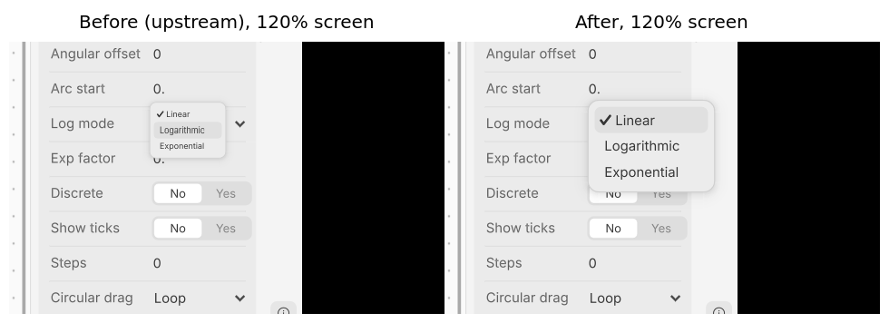

# Wayland: Start a popup with the scale of the window it belongs to

[← Overview](README.md) · **PR:** [plugdata-team/JUCE#9](https://github.com/plugdata-team/JUCE/pull/9) · JUCE `juce-master` ← `topemalheiro:pr/wayland-popup-scale` · 1 commit, +56 −1 in 3 files · Linux with Wayland only · needs nothing first

## What it does

**In short.** On KDE Wayland with a screen at 120%, plugdata's drop-down menus open tiny. I reproduced it on `develop`.

- **Before:** the Inspector's "Log mode" menu came out at 60% of its size (50% on a 100% screen next to a 120% one), with tiny text, a bit off its box.
- **After:** full size, right over the box.

The same on the 100% output: [popup-scale-before-after-100.png](images/popup-scale-before-after-100.png).

**Why.**

- JUCE sizes a menu by dividing the scale of the window it's opened from (1.2) by the scale of the menu's own new window. That code is in [juce_PopupMenu.cpp:436-460](https://github.com/topemalheiro/JUCE/blob/7eeea6b6f3c04a961744069b1ea9961be6d613dd/modules/juce_gui_basics/menus/juce_PopupMenu.cpp#L436-L460), and the PR doesn't change it.
- It asks for the menu window's scale the moment the window is created. On Wayland that's too early: the compositor only sends the surface its preferred scale after a roundtrip. Until then the peer reported the largest integer scale of all outputs, and KWin gives a 1.2 output an integer scale of 2. So the menu got 1.2 ÷ 2 = 0.6.

**What changes.** A popup now starts with the scale of the window it belongs to, until the compositor sends its own. plugdata needs no change of its own, only its JUCE pointer moved once this is merged.

## The code, in reading order

All in `modules/juce_gui_basics/native/`.

1. **[juce_Windowing_wayland_linux.cpp:1761-1769](https://github.com/topemalheiro/JUCE/blob/7eeea6b6f3c04a961744069b1ea9961be6d613dd/modules/juce_gui_basics/native/juce_Windowing_wayland_linux.cpp#L1761-L1769)** is a new helper, `getPopupOwner()`. If this peer is a popup, it returns the peer the popup belongs to; otherwise `nullptr`. The owner is already worked out when the popup is created; this only reads it.
2. **[juce_Windowing_wayland_linux.cpp:1752-1757](https://github.com/topemalheiro/JUCE/blob/7eeea6b6f3c04a961744069b1ea9961be6d613dd/modules/juce_gui_basics/native/juce_Windowing_wayland_linux.cpp#L1752-L1757)** changes the integer-scale guess for a surface that hasn't entered an output yet. A popup takes its owner's integer scale. Any other window still takes the largest of all outputs, as before. This part is for compositors without fractional scaling; KDE needs block 3.
3. **[juce_Windowing_wayland_linux.cpp:304-307](https://github.com/topemalheiro/JUCE/blob/7eeea6b6f3c04a961744069b1ea9961be6d613dd/modules/juce_gui_basics/native/juce_Windowing_wayland_linux.cpp#L304-L307)** runs once, when the popup's peer is constructed: it copies the owner's preferred scales into the popup, including the fractional 1.2. The comment says why it can't wait for the compositor.
4. **[juce_WaylandSurfaceScale_linux.h:67](https://github.com/topemalheiro/JUCE/blob/7eeea6b6f3c04a961744069b1ea9961be6d613dd/modules/juce_gui_basics/native/juce_WaylandSurfaceScale_linux.h#L67)** declares the copy function used in block 3, `inheritPreferredScales`, next to the other setters of `WaylandSurfaceScale`.
5. **[juce_WaylandSurfaceScale_linux.cpp:78-90](https://github.com/topemalheiro/JUCE/blob/7eeea6b6f3c04a961744069b1ea9961be6d613dd/modules/juce_gui_basics/native/juce_WaylandSurfaceScale_linux.cpp#L78-L90)** is that function. It copies the owner's two preferred scales (fractional and buffer), but only the ones this surface hasn't received yet, so the compositor's real answer always wins. It doesn't copy the owner's override scale: that's a scale a plugin host sets on its own window.
6. **[juce_WaylandSurfaceScale_linux.cpp:449-467](https://github.com/topemalheiro/JUCE/blob/7eeea6b6f3c04a961744069b1ea9961be6d613dd/modules/juce_gui_basics/native/juce_WaylandSurfaceScale_linux.cpp#L449-L467)** is a unit test. An owner at 1.2 (144 / 120) with an override of 1.5:
   - after the copy, the new surface is at 1.2 and has no override;
   - the compositor then says 1.5, and 1.5 wins;
   - a second copy doesn't undo it.

Block 3 is the actual fix (with block 5, the copy it calls). Block 2 does the same for compositors without fractional scaling, block 1 finds the owner, block 4 only declares block 5, and block 6 tests it.

How it was tested, and what wasn't, is in the PR description.
