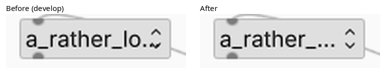

# Fix popup menu text running under its arrows

[← Overview](README.md) · **PR:** [plugdata-team/plugdata#2426](https://github.com/plugdata-team/plugdata/pull/2426) · plugdata `develop` ← `topemalheiro:pr/fix-popmenu-text-under-arrows` · 1 commit, +2 −1 in `Source/Objects/PopMenu.h` · needs nothing first

## What it does

**In short.** It's about the closed menu box, not the list that opens. A long item name was already cut off with "…", and still is. The PR only changes where it's cut.

- **Before:** the "…" sat under the ▲▼ arrows, so text and arrows overlapped.
- **After:** it's cut just before the arrows, so they don't overlap.

The PR doesn't change the box's size, only where the text stops.

**What you run into without it.** In a `[popmenu]`, an item whose name is too long for the box runs under the ▲▼ arrows on the right before it's cut short. I reproduced it on `develop` with a `[popmenu]` set to `width 100` and the item `a_rather_long_menu_item`: it showed "a_rather_lo.." on top of the arrows.

**Why.** The area the text may use was the whole box, shrunk by 2 px on each side. That area includes the strip on the right where the arrows are drawn. `drawText` ends a line that doesn't fit with "…", but only at the edge of the area it's given, which here was under the arrows.

**What changes.** The text's area now stops 16 px before the box's right edge. The arrows are drawn between 13 and 7 px from that edge, so a long item ends in "…" just left of them, with a 3 px gap. Short items look the same as before. It's drawing code, the same on every platform.

## The code, in reading order

Both lines are in the popup menu's `render` function.

1. **[PopMenu.h:212](https://github.com/topemalheiro/plugdata/blob/24cf688792b1bceab2cf994ac7af0bdde72d7f9d/Source/Objects/PopMenu.h#L212)** is a comment saying why the text area is cut.
2. **[PopMenu.h:213](https://github.com/topemalheiro/plugdata/blob/24cf688792b1bceab2cf994ac7af0bdde72d7f9d/Source/Objects/PopMenu.h#L213)** works out the rectangle the item's text is drawn in. It starts from the object's whole area, shrinks it by 2 px on every side, moves it 2 px right, and (the new part) cuts 16 px off its right side.

Block 2 is the whole fix; block 1 is its comment.

## Where the 16 px comes from (unchanged lines)

- [PopMenu.h:224](https://github.com/topemalheiro/plugdata/blob/24cf688792b1bceab2cf994ac7af0bdde72d7f9d/Source/Objects/PopMenu.h#L224) draws the text in that rectangle, left-aligned: `g.drawText(text, textBounds.toFloat(), Justification::centredLeft);`. The call doesn't mention "…", but `drawText` adds it by default (`useEllipsesIfTooBig = true`).
- [PopMenu.h:227](https://github.com/topemalheiro/plugdata/blob/24cf688792b1bceab2cf994ac7af0bdde72d7f9d/Source/Objects/PopMenu.h#L227) takes the rightmost 20 px of the box for the arrows: `b.removeFromRight(20)`.
- [PopMenu.h:229-240](https://github.com/topemalheiro/plugdata/blob/24cf688792b1bceab2cf994ac7af0bdde72d7f9d/Source/Objects/PopMenu.h#L229-L240) draws the two arrows, each from 3 px left of that strip's centre to 3 px right of it. The centre is 10 px from the box's right edge, so the arrows sit between 13 and 7 px from the edge.

With a box `W` px wide: shrinking by 2 and moving right by 2 puts the text between 4 and `W`. Cutting 16 px makes that 4 to `W - 16`, which ends 3 px before the arrows start at `W - 13`.

How it was tested, and what wasn't, is in the PR description.
