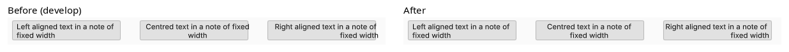
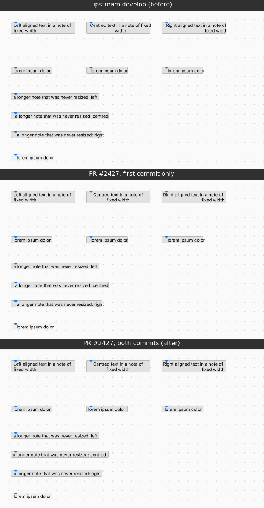

# Fix centred and right-aligned text in notes (#2427, and #2435 on top)

[← Overview](README.md) · **PRs:** [plugdata-team/plugdata#2427](https://github.com/plugdata-team/plugdata/pull/2427) (resized notes; `pr/fix-note-fixed-width-alignment`, 1 commit, +32 −4) and [plugdata-team/plugdata#2435](https://github.com/plugdata-team/plugdata/pull/2435) (notes that weren't resized too; `pr/fix-note-nonresized-alignment`, #2427 plus one commit, +26 −2 in all) · both in `Source/Objects/NoteObject.h` · need nothing first

**Update:** after your test showed right-aligned text running past a note that wasn't resized, that case is in a separate PR, #2435: it's #2427 plus one commit (2b308344f), so you can take it or leave it. The links below are at that commit, so they show both together. In #2427 alone, the helper is `alignsInFixedWidth(fixedWidth)` and also needs the note to be resized: `resized()` reads `x_resized` from the note's Pd data, and `getPdBounds()` passes it on to the height measurement.

## What it does

**In short.** In a centred or right-aligned `[note]`, centred text sat a bit right of centre, and right-aligned text ran past the box, whether the note was resized or sizes itself to its text. Now the text lines up with the box and stays inside it. Left-aligned notes don't change.

**What you run into without it.** A note you've resized keeps that width and wraps its text inside it. If it's centred, its text sits about 6 px right of the middle of the box; if it's right-aligned, the text runs past the box's right edge. A note that was never resized has the same problem, as you found. It shows clearly with "Outline" or "Fill background" on, and in edit mode.

**Why.** The note's text editor is 6 px wider than the box, and its text starts 7 px in from the left with no gap on the right. For left-aligned text that's fine. But centred text is centred on the area from 7 px in to 6 px past the box, and right-aligned text ends past the box. In Pd itself, ELSE moves such text so it's centred on the box or ends at its right edge ([note.c:194-207](https://github.com/timothyschoen/pd-else/blob/f92f4c83242d075526191d85b96eb5c8e10a0944/Source/Control/note.c#L194-L207)).

**What changes.** A centred or right-aligned note now lays out its text in exactly the box's width, with an even 2 px gap on each side. Its height is measured the same way, so the box still fits the text, and changing the alignment refits the text at once. A resized note's text area is 3 px narrower than before, so a line that only just fit now wraps a word earlier. A note that sizes itself to its text (text width + 12) still fits its text on one line. Left-aligned notes are laid out exactly as before. It's layout code, the same on every platform.

## The code, in reading order

First three small helper functions, then the places that use them.

1. **[NoteObject.h:235-237](https://github.com/topemalheiro/plugdata/blob/2b308344fa95bb540e24ac0e5181e601195a654d/Source/Objects/NoteObject.h#L235-L237)** is a comment saying which notes get the new layout and why.
2. **[NoteObject.h:238-241](https://github.com/topemalheiro/plugdata/blob/2b308344fa95bb540e24ac0e5181e601195a654d/Source/Objects/NoteObject.h#L238-L241)** is `alignsInBox()`: does this note get the new layout? Yes when it isn't left-aligned. `justification` is the Inspector's setting, numbered as in its list: 1 Left, 2 Centred, 3 Right.
3. **[NoteObject.h:243-248](https://github.com/topemalheiro/plugdata/blob/2b308344fa95bb540e24ac0e5181e601195a654d/Source/Objects/NoteObject.h#L243-L248)** chooses the gap around the text: 2 px left and right for those notes, the usual 7 px on the left and none on the right for the others. It only changes the editor's border when the border is different, because changing it makes the editor lay out its text again.
4. **[NoteObject.h:250-253](https://github.com/topemalheiro/plugdata/blob/2b308344fa95bb540e24ac0e5181e601195a654d/Source/Objects/NoteObject.h#L250-L253)** chooses the editor's width: exactly the box's width for those notes, the box plus 6 px for the others, as before.
5. **[NoteObject.h:255-259](https://github.com/topemalheiro/plugdata/blob/2b308344fa95bb540e24ac0e5181e601195a654d/Source/Objects/NoteObject.h#L255-L259)** is `resized()`. It sets the editor's border and width with blocks 3 and 4. Before, it was one line that always made the editor 6 px wider than the box: `noteEditor.setBounds(getLocalBounds().withTrimmedRight(-6));`.
6. **[NoteObject.h:283-288](https://github.com/topemalheiro/plugdata/blob/2b308344fa95bb540e24ac0e5181e601195a654d/Source/Objects/NoteObject.h#L283-L288)** is the start of `getTextHeightForWidth`, which measures how tall the text is at a given width: it sets the editor to that width for a moment, asks for the text's height, and puts it back. It now measures with the same border and width that will be shown (blocks 3 and 4), so the box is exactly as tall as its text.
7. **[NoteObject.h:437](https://github.com/topemalheiro/plugdata/blob/2b308344fa95bb540e24ac0e5181e601195a654d/Source/Objects/NoteObject.h#L437)** runs when the alignment changes in the Inspector. It calls `resized()` by hand, because the box keeps its size, so JUCE wouldn't call it, and the editor would keep the old width until the next resize.

Blocks 3 to 5 are the actual fix: the even gap and the box's own width, applied whenever the note is sized. Block 2 decides which notes get it, block 6 keeps the height right, and block 7 applies it straight away when the alignment changes.

## The numbers, before and after

Take a note `W` px wide.

- **Before:** the editor runs from 0 to `W + 6`, and its text area from 7 to `W + 6`. Centred text is centred at `(7 + W + 6) / 2 = W/2 + 6.5`, so about 6 px right of the box's middle. Right-aligned text ends at `W + 6`, past the box.
- **After (centred or right-aligned):** the editor runs from 0 to `W`, and its text area from 2 to `W - 2`. Centred text is centred at `W/2`, and right-aligned text ends inside the box. A note that sizes itself to its text is `W` = text width + 12 wide, so its text still fits on one line.
- **Left-aligned:** unchanged, 7 to `W + 6`. Keeping that width means the lines wrap exactly where they did before.

How it was tested, and what wasn't, is in the PR description.
