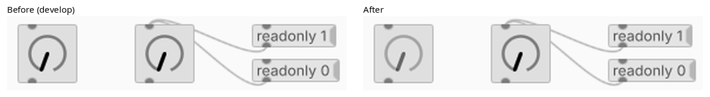

# Draw read-only knobs greyed out

[← Overview](README.md) · **PR:** [plugdata-team/plugdata#2429](https://github.com/plugdata-team/plugdata/pull/2429) · plugdata `develop` ← `topemalheiro:pr/fix-knob-readonly-greyed` · 1 commit, +21 −5 in `Source/Objects/KnobObject.h` · needs nothing first

## What it does

**In short.** A read-only knob can't be turned, but it looked exactly like one that can. Now it's drawn greyed out. It's a new look, not a bug fix, so it's the one of these PRs that's most a matter of taste.

In both pictures the left knob is read-only and the right one isn't.

**What you run into without it.** A `[knob]` can be made read-only: the Inspector's "Read only", the `-readonly` flag, or a `readonly 1` message from the patch. It then can't be turned with the mouse, but it looks exactly like one that can, so you can't see why it doesn't respond. I checked it on `develop` with `[knob -readonly]` next to a normal knob: they looked the same.

**Why.** Nothing in plugdata's knob drawing looked at read-only. In Pd itself, ELSE doesn't change the knob's look either ([knob.c:1497-1499](https://github.com/timothyschoen/pd-else/blob/f92f4c83242d075526191d85b96eb5c8e10a0944/Source/Control/knob.c#L1497-L1499) only stores the flag). So this is a look choice for plugdata.

**What changes.** A read-only knob is drawn greyed out:

- the value arc, the needle and the ticks lose their colour and fade;
- the arc behind them fades;
- the number label fades.

It redraws as soon as read-only changes, from the Inspector or from a `readonly` message, so a patch can visibly disable and enable a knob. The amounts of fading are plain constants (blocks 2, 3 and 9), easy to adjust. It's drawing code, the same on every platform.

## Two classes, and two `readOnly`s

`KnobObject.h` holds two classes, and both have a `readOnly`:

- **`Knob`** ([KnobObject.h:18-30](https://github.com/topemalheiro/plugdata/blob/c606ffd4486544bdc6a65f3c6097737eeb8566d0/Source/Objects/KnobObject.h#L18-L30)) is the dial that's drawn: arc, needle, ticks. Its `readOnly` (line 30) is a plain bool that also stops the mouse from turning it. Blocks 1 to 7 are in this class.
- **`KnobObject`** is the object around it: Inspector settings, the link to Pd, the number label. Its `readOnly` is the Inspector's "Read only" `Value`. Blocks 8 to 10 are in this class.

When the setting changes, `KnobObject` passes it to the dial with `knob.setReadOnly(...)` (block 10).

## The code, in reading order

1. **[KnobObject.h:357-361](https://github.com/topemalheiro/plugdata/blob/c606ffd4486544bdc6a65f3c6097737eeb8566d0/Source/Objects/KnobObject.h#L357-L361)** is `setReadOnly` on the dial. Line 360 is new: it asks for a repaint, so the new look shows at once. Before, read-only only changed how the knob reacts to the mouse, so there was nothing to redraw.
2. **[KnobObject.h:363-367](https://github.com/topemalheiro/plugdata/blob/c606ffd4486544bdc6a65f3c6097737eeb8566d0/Source/Objects/KnobObject.h#L363-L367)** gives the colour the dial's foreground is drawn with: the usual colour, or when read-only, the same colour with no saturation (grey), 80% of its brightness and 55% of its opacity.
3. **[KnobObject.h:369-372](https://github.com/topemalheiro/plugdata/blob/c606ffd4486544bdc6a65f3c6097737eeb8566d0/Source/Objects/KnobObject.h#L369-L372)** gives the colour of the arc behind the value: the usual one, or at 60% of its opacity when read-only.
4. **[KnobObject.h:73](https://github.com/topemalheiro/plugdata/blob/c606ffd4486544bdc6a65f3c6097737eeb8566d0/Source/Objects/KnobObject.h#L73)** draws the ticks in the colour from block 2 instead of the plain foreground colour.
5. **[KnobObject.h:276](https://github.com/topemalheiro/plugdata/blob/c606ffd4486544bdc6a65f3c6097737eeb8566d0/Source/Objects/KnobObject.h#L276)** draws the full arc, the track the value moves along, in the colour from block 3.
6. **[KnobObject.h:285](https://github.com/topemalheiro/plugdata/blob/c606ffd4486544bdc6a65f3c6097737eeb8566d0/Source/Objects/KnobObject.h#L285)** draws the value arc in the colour from block 2.
7. **[KnobObject.h:298](https://github.com/topemalheiro/plugdata/blob/c606ffd4486544bdc6a65f3c6097737eeb8566d0/Source/Objects/KnobObject.h#L298)** draws the needle in the colour from block 2.
8. **[KnobObject.h:909](https://github.com/topemalheiro/plugdata/blob/c606ffd4486544bdc6a65f3c6097737eeb8566d0/Source/Objects/KnobObject.h#L909)** is in `KnobObject`'s drawing. A square knob with "Show arc" off draws a thin ring instead of the arc, and that ring now uses the colour from block 3 too.
9. **[KnobObject.h:1017-1018](https://github.com/topemalheiro/plugdata/blob/c606ffd4486544bdc6a65f3c6097737eeb8566d0/Source/Objects/KnobObject.h#L1017-L1018)** is in `updateLabel`. When the knob is read-only, the label's text colour is drawn at half opacity, so it fades with the knob.
10. **[KnobObject.h:1292-1297](https://github.com/topemalheiro/plugdata/blob/c606ffd4486544bdc6a65f3c6097737eeb8566d0/Source/Objects/KnobObject.h#L1292-L1297)** runs when "Read only" changes, from the Inspector or from a `readonly` message ([KnobObject.h:791-795](https://github.com/topemalheiro/plugdata/blob/c606ffd4486544bdc6a65f3c6097737eeb8566d0/Source/Objects/KnobObject.h#L791-L795) sets it). It already stored the flag in Pd and passed it to the dial. Lines 1296-1297 are new: they rebuild the number label (block 9) and repaint the object, so the whole knob changes at once.

Blocks 2 and 3 are the actual change: the greyed colours. Blocks 4 to 9 draw with them, and blocks 1 and 10 make the change show straight away.

How it was tested, and what wasn't, is in the PR description.
